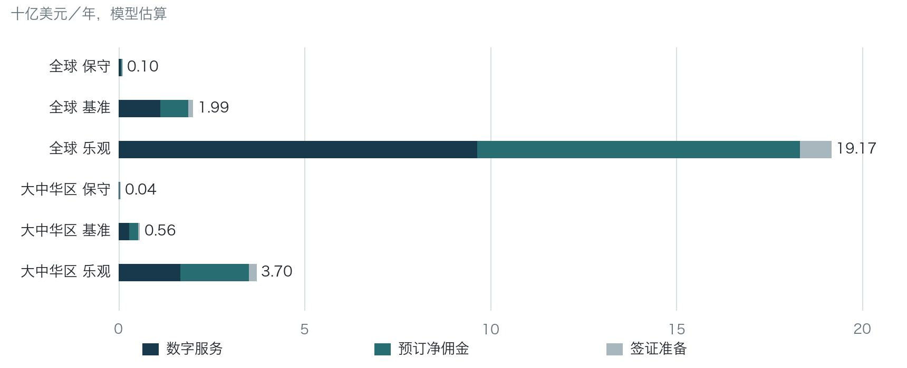
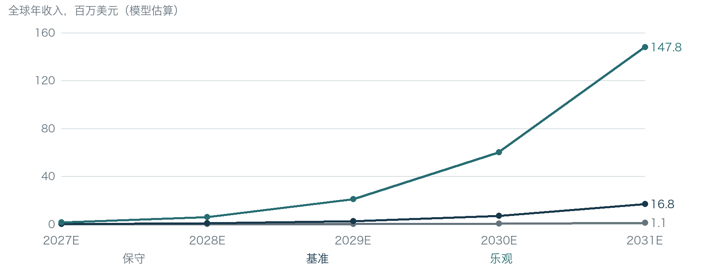
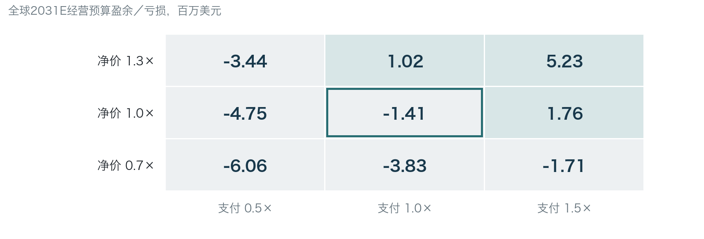
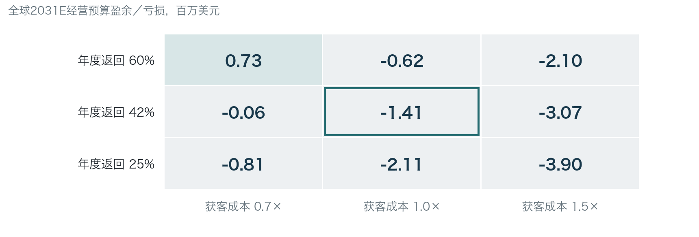

<!-- page -->

# Luya 全球与大中华区
市场研究

基准情景下，Luya可变现的全球整合TAM约1.99十亿美元，大中华区约564.5百万美元。收缩到可服务地域、语言和渠道后，全球近端SAM约155.9百万美元；按新增账户、年度返回及容量逐年推演，2031E全球SOM约16.8百万美元。市场足以支撑细分产品，尚不能单凭规模证明平台扩张成立。

**Exhibit 1  基准SOM远小于TAM，规模来自可触达账户而非任意份额**

| 百万美元／年 | TAM* | 近端SAM* | 扩展SAM* | 2029E SOM* | 2031E SOM* |
|---|---|---|---|---|---|
| 全球／保守 | 95.3 | 6.6 | 24.7 | 0.2 | 1.1 |
| 全球／基准 | 1,994.8 | 155.9 | 574.7 | 2.6 | 16.8 |
| 全球／乐观 | 19,165.2 | 1,478.4 | 6,087.8 | 20.9 | 147.8 |
| 大中华区／保守 | 41.3 | 5.7 | 17.4 | 0.1 | 0.7 |
| 大中华区／基准 | 564.5 | 120.2 | 317.2 | 1.4 | 10.0 |
| 大中华区／乐观 | 3,702.3 | 995.2 | 2,608.6 | 10.3 | 82.5 |
来源：公开旅游统计及Luya研究模型。*分析师情景，低置信度，非统计置信区间；2025数量基础、2026报价与固定美元，2027E–2031E为假设经营期。Global已含大中华区。

### 投资判断：先投可验证任务，再决定平台扩张

建议优先验证少数目的地的可执行Trip Plan，并给予Visa.Master同等的商业胜出机会。全球基准2031E收入16.8百万美元，经营预算仍亏损1.4百万美元；达到高收入需要支付、获客、服务成本及交易变现同时改善。当前研究支持设门槛的小规模验证，未形成可直接采用的估值或融资回报判断。

Local Friend的潜在价值在经授权、稀缺且能改变旅行决策的本地内容；Credits应降低有效供给成本或带来有偿复用。两者均需实测，不能预先作为数据壁垒、现金收入或高留存的证明。免费OTA助手、地图与通用AI是主要反方。

研究对象：规划中的16个功能域、116项功能，非已上线业绩。基础资料截止2026-10-29；本版补充来源与模型制作截至2026-10-30。*整合市场含未来预订／签证能力，当前获批合同未验证；纯数字服务另列于正文。

阅读导航：市场2–8页｜竞争与进入9–11页｜财务12–17页｜执行与风险18–21页｜附录22–27页。

<!-- page -->

## 旅行消费很大，Luya收入池需要逐层收窄

**Exhibit 2  2025年旅游需求提供规模背景，各统计量不能直接相加**

| 地域／指标 | 2025数量 | 统计单位与边界 |
|---|---|---|
| 全球国际到访 | 1.544bn | 目的地过夜到访；provisional [S01] |
| 全球国内消费 | USD5.63tn | WTTC／Oxford模型估计 [S03] |
| 全球国际游客消费 | USD2.02tn | 行业消费；不是平台收入 [S03] |
| 中国大陆境内游 | 6.522bn／CNY6.30tn | 人次／游客消费 [S02] |
| 中国大陆出境 | 148.36m | 客源出境人次，含港澳台 [S02] |
| EU27国内旅行 | 848m／EUR266.2bn | 15岁以上居民过夜旅次／支出 [S05] |
| 美国国内旅行 | 2.40bn／USD1.185tn | 行业模型；支出为2025不变美元 [S04] |
| 台湾国内旅行 | 247.614m／TWD564.3bn | 12岁以上国民；含即日游 [S06] |
| 香港／澳门居民离境 | 117.542m／42.901m | 全部边境事件，含例行往返 [S07–08] |
| 台湾居民／国民出国 | 18.944m | 原表全龄国民口径 [S40] |
来源：S01–08、S40。bn=十亿，m=百万，tn=万亿；年龄、居民／国籍、即日／过夜、目的地／客源口径不同。

旅游支出证明经济活动存在，但支付主要流向交通、住宿、餐饮与体验供应商。Luya能获得的收入是用户愿意额外支付的服务价，或在可归因且完成的交易中取得的净佣金。将数万亿美元行业支出直接乘一个泛化AI渗透率，会跳过付款主体、免费替代与收入权利。

全球国内旅次缺乏可直接采用的同口径2025总数。本次恢复的UN Tourism原始工作簿仅到2024年，且没有World汇总。因此以WTTC国内消费除以明确的单旅次支出假设，形成旅次当量；美国、欧盟、大陆与台湾的异质数据仅校准数量级。

增长方向优于规模精度。WTM／Tourism Economics在2025年报告中预测2030国际到访超过20亿；UN在2011年发布的18亿预测更早。它们说明需求可能继续增长，却都不测量AI增量支付，不能直接转为Luya收入CAGR。[S38–39]

<!-- page -->

## AI触达已成规模，旅行付费仍需独立识别

**Exhibit 3  AI采用与旅行增长提供时机，不能替代商业转化**

| 指标／来源 | 已发表数据 | 模型用途与边界 |
|---|---|---|
| 中国生成式AI用户 [S41] | 2025年底6.02亿 | 来源普及率42.8%，分母非旅行者 |
| 中国AI用户规模 [S42] | 2026上半年突破7亿 | 严格下界；不算精确增长率或付费人数 |
| 2030国际到访 [S39] | 18亿，2011年发布预测 | 长期需求背景，预测较早 |
| 2030全球到访 [S38] | 超过20亿，2025年报告 | 阈值，范围与UN未完全同口径 |
| 2030国际目的地消费 [S38] | USD2.5tn预测 | 名义／实际基年未充分拆明 |
| 2025–30旅行支出CAGR [S38] | 欧洲6%／亚洲10%／北美4% | 区域定义不同；不输入AI收入增长 |
| China出境休闲支出 [S38] | 至2030较2025累计+93% | 非CAGR，China边界未完整拆明 |
来源：S38–39、S41–42。调查／摘要方法不完全相容；数据均为原来源口径，未用AI用户比例直接乘旅游总量。

旅行存在较适合AI的高信息负担任务：比较约束、把地点按地理排序、衔接预约、理解当地信息，以及将旅中变化传回计划。多模态让现场问答与拍前指导更自然；agentic接口则可能缩短从发现到预订的链条。价值实现仍取决于实时正确性、权限、付款确认与售后，而不只是生成一份流畅文本。

采用的另一面是供给同质化。TripGenie免费问答、Qwen生态接入与Ask Maps说明大型入口正在提供类似能力；Pixel Camera Coach直接进入拍前指导。消费者更容易尝试AI，并不意味着愿为另一个旅行App增付。Luya应测量完成同一任务的增量支付与成本节约，避免把兴趣调查称为产品市场匹配。[S16–19]

到2030最可信的判断是旅行需求与AI接口继续相互渗透；最不可信的是从某个“AI旅游市场”摘要反推Luya收入。公司模型因此只设1%／3%／5%的旅次增长假设，并把支付、分发、留存与容量另列。模型增长主要由经营参数推动，未把旅游支出预测当成AI收入增速。

<!-- page -->

## 从人旅次到付款账户，去重是估值前提

**Exhibit 4  全球分母从支出代理建立，支付率只作用于相容单位**

| 关键驱动／单位 | 保守 | 基准 | 乐观 |
|---|---|---|---|
| 国内单次支出假设／USD | 500 | 350 | 250 |
| 国内旅次当量／bn | 11.26 | 16.09 | 22.52 |
| 每次跨境链的目的地数* | 1.30 | 1.15 | 1.05 |
| 全球客源旅次当量／bn | 12.41 | 17.41 | 23.99 |
| 平均同行人数／付款组* | 1.9 | 1.7 | 1.5 |
| 平均年旅次／账户当量* | 2.5 | 3.0 | 3.5 |
| 旅行AI品类采用率* | 20% | 40% | 60% |
| 年订阅账户比例* | 1.5% | 4.0% | 8.0% |
| 非订阅旅次付费率* | 4% | 10% | 18% |
来源：S01、S03及分析师模型。*以上转换率、频次与付费率均未实测；“账户当量”是计算单位，非已观察的独立用户。

计算顺序为：客源旅次当量→休闲／FIT／移动可服务的联合过滤→付款旅行组→年度账户当量→品类采用→互斥的年订阅与按次付款。联合过滤直接设情景，避免把多个不相容调查的边际比例当作联合概率。

Global已含大中华区。大陆、香港、澳门、台湾按客源分列；跨区旅行归于出发客源，不叠加目的地入境量。ROW是全球当量减四地的残差，而非独立实测地区总数。台湾年龄／居民口径、港澳旅游目的及跨境行程链均通过假设桥接。

年订阅涵盖的旅行不再收按次套餐费；多模块共享一次付款。订阅者假设更高频，剩余非订阅旅次由总量扣回，保持旅行总数恒等。只有额外、明确排除在套餐外的预订佣金与签证准备任务，才增加收入。

<!-- page -->

## 全球基准TAM约20亿美元，扩展收入占比不可忽略

**Exhibit 5  纯数字服务与交易扩展分别展示，避免把未来合同写成现有收入**

来源：公开旅游数据及模型。单位：十亿美元／年；*数字服务为互斥付款池，预订／签证为未来可交付情景，非已签合同。

**Exhibit 6  基准整合市场由数字收入与两类额外服务构成**

| 百万美元／年 | 全球 | 大中华区 |
|---|---|---|
| 数字订阅／旅行套餐 | 1,122.8 | 290.2 |
| 预订净佣金扩展 | 757.7 | 235.2 |
| 签证准备净服务扩展 | 114.3 | 39.1 |
| 整合TAM | 1,994.8 | 564.5 |
来源：integrated_market_model。*同一旅客可购买不同权利，但各模块付款人数不相加为独立客户数。

极宽的情景区间来自全球旅次代理、服务相关性、采用、付费与价格的联动，而非精确抽样误差。基准值适合比较商业结构；保守与乐观分别用于检验失败成本与上行所需条件。乐观情景不能视为等概率预测。

可比与预算强度只作合理性检查。数字服务价可参考音频导览与旅行组织工具；OTA集团收入／GMV比率则包含商户、代理及其他业务，不能作Luya净affiliate佣金。共享输入的三角校验也不是独立验证。

<!-- page -->

## 大中华区由大陆规模主导，四地应分别定价与交付

**Exhibit 7  基准四地整合TAM、SAM与2031E收入均可独立核对**

| 百万美元／年 | TAM* | 近端SAM* | 扩展SAM* | 2031E SOM* |
|---|---|---|---|---|
| 中国大陆 | 523.1 | 104.6 | 287.7 | 6.9 |
| 香港 | 10.2 | 4.6 | 7.7 | 0.8 |
| 澳门 | 0.8 | 0.3 | 0.6 | 0.2 |
| 台湾 | 30.4 | 10.6 | 21.3 | 2.1 |
| 大中华区 | 564.5 | 120.2 | 317.2 | 10.0 |
来源：公开旅游统计及Luya研究模型。*分析师情景，低置信度，非统计置信区间；2025数量基础、2026报价与固定美元，2027E–2031E为假设经营期。Global已含大中华区。

**Exhibit 8  基准本币测试价明确分开，未把相邻产品价格视为Luya实付**

| 客源／币种 | 年套餐* | 单次旅行* | 签证准备* |
|---|---|---|---|
| 中国大陆／CNY | 149 | 29 | 199 |
| 香港／HKD | 288 | 58 | 288 |
| 澳门／MOP | 288 | 58 | 288 |
| 台湾／TWD | 990 | 199 | 990 |
| 其他地区／USD | 39 | 9.99 | 39 |
来源：分析师报价假设；排除间接税与代收款。FX固定2026-10-23；澳门由1.03 MOP/HKD联系汇率假设推导，非同期现汇。

大陆的国内与出境旅次构成主要量基。中文出境FIT可成为验证对象，原因是跨语言、预约和多工具切换的任务较明确；这不代表该客源已证明有更高支付或更低CAC。港澳边境往返包含大量非旅游活动，必须先折为有意义旅行，不能使用全数离境乘付费率。

台湾国内调查与出国统计的年龄、国籍和频率不同，模型采取折扣与更高年度旅行频次。香港TripIt价格与台湾、澳门美图SKU可检验消费工具的价格量级，但产品权利并不相同。本币报价、渠道准入、客服语言与支付方式应逐地测试。

模型另含港澳本地staycation旅次假设；普通日常拍照、餐饮与导航未另加TAM。四地不是同一市场的统一价格复制。

<!-- page -->

## SAM取决于服务覆盖，扩城应受交付能力约束

**Exhibit 9  数字服务SAM与整合SAM分列，暴露合同依赖**

| 基准／百万美元年收入 | 全球 | 大中华区 |
|---|---|---|
| 数字服务TAM | 1,122.8 | 290.2 |
| 数字服务近端SAM | 82.7 | 61.9 |
| 整合近端SAM | 155.9 | 120.2 |
| 数字服务扩展SAM | 313.0 | 163.2 |
| 整合扩展SAM | 574.7 | 317.2 |
来源：模型。*SAM按语言、目的地、渠道、合规与可交付性作联合覆盖折扣；不是现有Luya服务城市或合同清单。

**Exhibit 10  基准覆盖率按客源分别约束，不因语言通用便视为全覆盖**

| 客源 | 近端覆盖* | 扩展覆盖* | 主要执行约束 |
|---|---|---|---|
| 中国大陆 | 20.0% | 55.0% | 目的地维护、渠道与本地支付 |
| 香港 | 45.0% | 75.0% | 双语交付、支付与行程范围 |
| 澳门 | 40.0% | 70.0% | 小客源、渠道与目的地范围 |
| 台湾 | 35.0% | 70.0% | 繁体、支付、旅次频率与年龄 |
| 其他地区 | 2.5% | 18.0% | 英语城市起步，非全世界 |
来源：分析师计划假设；无已验证的渠道容量或市场准入比例。

近端SAM代表能够建立有限服务的条件池；扩展SAM要求更多城市内容、实时数据、支付及售后能力。它们都不是用户获取预算。一个被市场规模筛选为可服务的人群，仍可能因为渠道无法有效触达而无法进入SOM。

本模型让公司覆盖逐年从近端走向扩展，同时对每地活跃账户设容量上限。Y1不计预订与签证扩展收入，之后按假设逐步启用。若合同或质量门未通过，扩展收入应归零并重跑，而非用TAM填补预算缺口。

<!-- page -->

## 多模块可以提高价值，但不能叠加同一笔付款

**Exhibit 11  基准数字收入只分配一次，扩展服务才增加收入**

| 模块 | 数字池分配* | 全球TAM／USDm | 大中华TAM／USDm |
|---|---|---|---|
| Trip Plan／预约任务 | 35% | 393.0 | 101.6 |
| Local Friend／导览 | 30% | 336.8 | 87.1 |
| 拍照／回忆 | 25% | 280.7 | 72.5 |
| 预算／分账／协作 | 10% | 112.3 | 29.0 |
| 预订净佣金 | 增量权利 | 757.7 | 235.2 |
| 签证准备服务 | 增量权利 | 114.3 | 39.1 |
| 合并平台收入 | 已去重 | 1,994.8 | 564.5 |
来源：模型module_bridge。*35/30/25/10%为分析分摊，非观测模块偏好或独立模块TAM；四项之和等于同一数字付款池。

旅行套餐可以包含路书、旅中问答、拍照、记账与回忆。假设用户为套餐付一次款，再把各功能的“独立市场规模”全部相加会重复计价。这里按固定权重解释功能贡献，不能据权重判断应给哪个模块更多研发预算。

预订按完成、归因且已结算的GMV乘净费率计算；公开Viator8%与GetYourGuide up to8%仅为政策参照，本模型采用更低净佣金情景。用户向酒店、航空公司或政府支付的本金均排除。签证准备另售时，套餐必须明确排除相同权利。[S25–26]

**Exhibit 12  按权益而非按页面点击记录收入，防止隐性重复**

| 付款情形 | 收入处理 | 成本处理 |
|---|---|---|
| 年套餐内使用多个功能 | 确认一次数字收入 | 所有实际使用均计交付成本 |
| 单次旅行用Credits兑换 | 不把面值新增为现金 | 计预期兑换履约／审核成本 |
| 套餐用户另订活动 | 仅合资格净佣金 | 售后与退款成本另计 |
| 材料准备与政府签证费 | 仅净辅助服务价 | 人工／合规／文档成本另计 |
来源：产品边界与模型政策；实际收入确认须按主体合同和会计判断复核。

<!-- page -->

## OTA已拥有交易与分发，免费AI提高独立收费门槛

**Exhibit 13  2025公开财务规模说明竞争资源，不能移作Luya佣金率**

| 集团 | 年度收入 | 交易规模 | 解释边界 |
|---|---|---|---|
| Booking | USD26.9bn | Gross bookings USD186.1bn | 收入／GB约14.5%，非affiliate费率 [S11] |
| Expedia | USD14.733bn | Gross bookings USD119.590bn | 集团多种模式，非单一AI业务 [S12] |
| Airbnb | USD12.241bn | GBV USD91.3bn | 住宿／体验；533m夜晚及席位混合 [S13] |
| Trip.com Group | CNY62.4bn | 不采用异口径交易总量 | 包括携程／去哪儿，品牌不再相加 [S14] |
| 同程旅行 | CNY19.396bn | 平均月付费用户45.5m | 交易用户，非AI付费人数 [S15] |
来源：S11–15；公司公开业绩，观察年2025。货币、业务组合及财务范围不同，不据此排列Luya估值倍数。

**Exhibit 14  主要替代品各自占据一段用户流程**

| 平台／工具 | 核实能力 | 对Luya的直接含义 |
|---|---|---|
| TripGenie | 免费旅行问答、行程与商品发现 | 规划本身难以形成独立价格 [S16] |
| Qwen／飞猪／高德 | 公开测试规划、预订与导航链路 | 生态入口可免费分发；非全旅行原生付款 [S17] |
| Ask Maps | 场景问答与行程发现 | 初期美印移动端，不能声称中国可用 [S18] |
| 小红书 | 本地经验、分享与发现 | 内容与注意力竞争，Luya CAC未知 |
| Mindtrip | 偏好、规划预订及变更提醒 | 闭环功能趋同，当前独立价格未核 [S20] |
来源：S16–20及当前竞争表。判断为作者分析；不将产品声明视为效果或用户规模。

可能的竞争反应是将规划、对话与提醒免费加入现有交易链，以订单佣金补贴推理与分发。Luya需要证明更准确的任务执行、可维护的预约信息或授权本地内容产生额外净支付；“模型更聪明”与“功能更多”不足以抵消入口差距。

<!-- page -->

## 有价格参照，仍须证明Luya的增量支付

**Exhibit 15  相邻付费工具与免费替代并存，价格不可跨权利外推**

| 参照 | 可核价格／状态 | 付款单位与分析边界 |
|---|---|---|
| VoiceMap | USD5.99–29.99 | 每份预制音频游览许可；非AI对话 [S22] |
| TripIt Pro／HK | HKD388／年 | 所列旅行组织SKU；非完整路书 [S23] |
| 美图秀秀／CN | CNY15／月；128／年 | 所列VIP；侧重后期图像 [S24] |
| Wanderlog Pro | Starting at $39.99／年 | 地区／ISO币种未锁，不写USD |
| Pixel Camera Coach | 未核独立收费 | 拍前构图与光线直接替代 [S19] |
| Layla | 条款称停止新Premium | 当前条款矛盾；不能推断失败原因 [S21] |
| iVisa US | ESTA from USD129.99 | 总价，不等于材料服务净价 [S37] |
| Viator／GYG | 8%／up to8% | 公开affiliate政策，不代表已获批 [S25–26] |
来源：所列编号与当前定价证据；报价为提取时产品页面值，不保证执行日不变。

按次付费与年订阅服务不同人群。低频用户可能只为一份可执行计划付费；高频旅行者只有在全年多次成功使用且订阅经济划算时才续费。基准模型假设4%的品类活跃账户订年套餐，其余旅次10%按次付款；两者不是已观察的Luya转化率。

模型用较少的可编辑参数承接未知，而非由调查中的AI兴趣直接推付费。大陆基准旅行价CNY29、年价149；ROW旅行价USD9.99、年价39。保守价格为基准70%，乐观135%，退款相应为8%／5%／3%。对照应使用相同任务、交付范围与退款窗口，不以更宽套餐制造虚假优越。

### 价格与覆盖的可迁移性，比单一标价更关键

公开标价只能证明某类权利被提供出售；它没有披露成交率、折扣、退款或获客成本。定价测试应锁定一个旅行组的实际权益，同行共享不逐人再收一次。港澳台的不同价格层级及支付渠道分别检验，统一账户并不意味着统一购买力。

<!-- page -->

## 以可执行Trip Plan起测，真实贡献利润决定先后

**Exhibit 16  五个切口采用同一标准，排名是验证顺序而非胜率**

| 候选 | 付费任务清晰度 | 差异化可能 | 主要成本／风险 | 验证优先序* |
|---|---|---|---|---|
| 窄范围Trip Plan | 高：路线与预约可验收 | 可靠执行、同行共享 | 实时核验；免费竞争 | 1 |
| Visa.Master | 高：材料准备任务 | 一致性与准备链路 | 人工例外、资格与隐私 | 2，可升至1 |
| Local Friend | 中：本地理解偏主观 | 授权稀缺经历 | 采集、权利、更新成本 | 3，先单城 |
| AI拍照 | 中：拍摄效果可盲评 | 交互与设备适配 | 原生相机、多模态延时 | 4 |
| 轻量综合旅伴 | 中：跨任务价值待证 | 上下文复用 | 功能范围、冷启动 | 5 |
来源：竞争、定价与产品范围的综合分析。*作者判断；无加权伪精确分数，现有开发进度不参与商业排名。

建议并列测试大陆中文出境城市行程与英语欧洲城市短途行程。前者检验跨语言与预约价值，后者检验成熟免费工具环境下是否仍有增量。先按官方信息可维护、实际交付能力、可招募近期旅行组和授权供给选四城以内的任务范围，不预先宣告某城市最优。

首个交付应从已有目的地、日期、预订出发：地理顺序合理，重要预约有来源与核验时间，形成同行共享的路线与待办。签证若在同定义真实支付和全成本贡献上胜出，应成为先行入口，再由用户选择复用行程资料。

### 分发从高意图任务开始，预算只是一项经营提案

可核验预约内容、搜索、同伴邀请与目的地合作是候选渠道。自然内容同样有制作成本；创作者伙伴并非已签供给。模型的获客开支拆到搜索、社交和创作者渠道，再扣重复及容量，保留每个来源的激活、付款、退款和交付归因。没有执行数据前，不能称为可复制渠道。

若免费对照达到相同可靠性且用户不增付，Trip Plan下调；若签证或授权本地内容获得更好净贡献，则重排。不靠整合更多功能回避单任务失败。

<!-- page -->

## 全球五年模型：收入增长仍需覆盖获客与交付成本

**Exhibit 17  基准收入、成本与现金由同一账户和旅次体系生成**

| 百万美元，除注明外 | 2027E | 2028E | 2029E | 2030E | 2031E |
|---|---|---|---|---|---|
| 活跃账户当量／m | 0.07 | 0.23 | 0.64 | 1.56 | 3.23 |
| 服务旅行组旅次／m | 0.21 | 0.73 | 2.04 | 4.97 | 10.24 |
| 付费账户当量／m* | 0.02 | 0.07 | 0.19 | 0.47 | 0.97 |
| 数字订阅收入 | 0.07 | 0.26 | 0.72 | 1.73 | 3.52 |
| 按次数字收入 | 0.12 | 0.42 | 1.16 | 2.78 | 5.59 |
| 预订净佣金 | 0.00 | 0.10 | 0.62 | 2.31 | 6.71 |
| 签证准备净收入 | 0.00 | 0.01 | 0.08 | 0.31 | 0.93 |
| 整合年收入 | 0.20 | 0.79 | 2.58 | 7.14 | 16.75 |
| 交付及平台COGS | 0.16 | 0.40 | 1.04 | 2.55 | 5.57 |
| 毛利 | 0.04 | 0.39 | 1.54 | 4.59 | 11.18 |
| 支付／渠道费 | 0.03 | 0.11 | 0.31 | 0.76 | 1.59 |
| 获客预算 | 0.20 | 0.60 | 1.50 | 3.00 | 5.00 |
| 获客后贡献利润 | -0.19 | -0.32 | -0.27 | 0.83 | 4.59 |
| 人员／内容／管理预算 | 0.90 | 1.50 | 2.50 | 4.00 | 6.00 |
| 经营预算盈余／亏损 | -1.09 | -1.82 | -2.77 | -3.17 | -1.41 |
| 开发现金投入 | 0.10 | 0.15 | 0.20 | 0.25 | 0.30 |
| 简化经营现金流* | -1.19 | -1.97 | -2.97 | -3.42 | -1.71 |
来源：分析师预算模型。*付费账户为退款前发生收费的等效账户，非净留存付款人数；收入扣退款。现金流为经营预算减开发投入，未含税、营运资金、利息与融资；非会计盈利预测。

本表为全球经营提案，含大中华区。模型预算非已发生费用；Global与大中华区不可相加。

<!-- page -->

## 大中华区五年模型：收入增长仍需覆盖获客与交付成本

**Exhibit 18  基准收入、成本与现金由同一账户和旅次体系生成**

| 百万美元，除注明外 | 2027E | 2028E | 2029E | 2030E | 2031E |
|---|---|---|---|---|---|
| 活跃账户当量／m | 0.04 | 0.15 | 0.42 | 1.05 | 2.26 |
| 服务旅行组旅次／m | 0.15 | 0.49 | 1.37 | 3.45 | 7.33 |
| 付费账户当量／m* | 0.01 | 0.05 | 0.13 | 0.32 | 0.69 |
| 数字订阅收入 | 0.04 | 0.14 | 0.39 | 0.98 | 2.09 |
| 按次数字收入 | 0.06 | 0.21 | 0.59 | 1.47 | 3.09 |
| 预订净佣金 | 0.00 | 0.06 | 0.36 | 1.41 | 4.23 |
| 签证准备净收入 | 0.00 | 0.01 | 0.05 | 0.18 | 0.57 |
| 整合年收入 | 0.10 | 0.42 | 1.39 | 4.05 | 9.98 |
| 交付及平台COGS | 0.10 | 0.25 | 0.67 | 1.67 | 3.75 |
| 毛利 | 0.01 | 0.16 | 0.73 | 2.38 | 6.23 |
| 支付／渠道费 | 0.02 | 0.06 | 0.16 | 0.42 | 0.91 |
| 获客预算 | 0.12 | 0.36 | 0.90 | 1.80 | 3.00 |
| 获客后贡献利润 | -0.13 | -0.25 | -0.33 | 0.16 | 2.32 |
| 人员／内容／管理预算 | 0.54 | 0.90 | 1.50 | 2.40 | 3.60 |
| 经营预算盈余／亏损 | -0.67 | -1.15 | -1.83 | -2.24 | -1.28 |
| 开发现金投入 | 0.06 | 0.09 | 0.12 | 0.15 | 0.18 |
| 简化经营现金流* | -0.73 | -1.24 | -1.95 | -2.39 | -1.46 |
来源：分析师预算模型。*付费账户为退款前发生收费的等效账户，非净留存付款人数；收入扣退款。现金流为经营预算减开发投入，未含税、营运资金、利息与融资；非会计盈利预测。

本表为全球经营提案中的四地子集。模型预算非已发生费用；Global与大中华区不可相加。

<!-- page -->

## 三情景财务并列，增长不能替代现金约束

**Exhibit 19  收入上行需要预算、支付与交付效率同时改善**

来源：模型。2027E–2031E为假设启动期；三情景同时改变预算、支付、成本与容量，非来源给出的预测区间。

**Exhibit 20  保守情景亏损持续，基准尚未达到公司层面盈亏平衡**

| 2031E／百万美元 | 收入 | 经营盈余／亏损 | 五年最低资金缺口* |
|---|---|---|---|
| 全球／保守 | 1.1 | -7.4 | 18.3 |
| 全球／基准 | 16.8 | -1.4 | 11.3 |
| 全球／乐观 | 147.8 | 96.4 | 1.0 |
| 大中华区／保守 | 0.7 | -4.6 | 11.2 |
| 大中华区／基准 | 10.0 | -1.3 | 7.8 |
| 大中华区／乐观 | 82.5 | 52.0 | 0.9 |
来源：模型。*缺口为简化经营现金流累计低点；未含流动性缓冲、所得税、营运资金与融资费用，不是建议融资额。

乐观情景包含较低单位成本、较强支付和较高容量，数值上具备规模收益；这种同步改善需要经营证据。若只有行业需求增长而收费与分发不改善，保守情景说明低ARPU可使扩大服务量增加亏损。资金使用应与可验证里程碑绑定。

<!-- page -->

## 免费使用也有成本，ARPU与CAC必须同分母比较

**Exhibit 21  基准2031E单位经济显示正毛利不等于公司盈利**

| 指标／单位 | 全球 | 大中华区 |
|---|---|---|
| 每活跃账户收入／USD | 5.19 | 4.43 |
| 数字收入／活跃账户／USD | 2.83 | 2.29 |
| 数字收入／收费账户当量／USD | 9.44 | 7.54 |
| 毛利率* | 66.7% | 62.4% |
| 获客后贡献率* | 27.4% | 23.3% |
| 核心新增净付款账户CAC／USD* | 11.01 | 8.42 |
| 活跃账户稳态贡献LTV／USD* | 5.13 | 4.07 |
| 免费旅次用量成本／USDm | 1.67 | 1.20 |
| 完整用量成本／USDm | 2.05 | 1.47 |
| Credits兑换成本／USDm | 0.26 | 0.18 |
来源：模型。*全为计划假设；CAC按退款折扣后的新增净付款账户，LTV按所有活跃账户且含平台固定COGS，分母不同，不可直接除为LTV/CAC。非成熟cohort回收期。

公开token价并非全成本。Gemini2.5 Flash标准文本价为USD0.30输入／2.50输出每百万token；Qwen-plus北京档CNY0.8输入／2输出每百万token。视觉、音频、搜索grounding、地图、重试、存储、客服与编辑另计。模型将这些作为完整用量预算，再单列付款支持、Credits、扩展售后及固定平台成本。[S27–29]

渠道费用亦不能机械叠加。香港Stripe本地卡标准费含比例与每笔固定额；应用商店或小程序数字支付路径另有资格和地区规则。本模型以12%／15%／18%综合现金扣费假设压力测试，未宣称Luya已享受特定商户费率。[S30]

LTV是稳态年度贡献除以流失率的简化量，非已观测客户生命周期价值。年度留存、退款后真实付款人数、免费流量成本和渠道混合需共同校准；在此之前不报告虚假的实绩回收期或投资回报率。

<!-- page -->

## 支付与价格同时受压，基准盈利空间很薄

**Exhibit 22  支付与净价二维变化足以改变2031E经营结果**

来源：基准模型逐格重算。*支付倍率同时调整订阅份额与按次支付率；净价倍率调整数字及签证价，预订佣金不变。边框为基准。

**Exhibit 23  获客成本与年度返回影响收入，但交付容量可能截断上行**

来源：基准模型。*获客成本为每新增激活账户成本，不是付费CAC；年度返回是假设，非D30活跃。每格重算SAM／容量上限、费用与收入。

二维表是条件敏感性，不是概率分布。若合同无法启用、全栈用量比预算高或免费竞争压低支付，收入与贡献将进一步下降。应先替换可观测的高杠杆参数，再扩大预算，不能用乐观情景抵消未解决的成本。

<!-- page -->

## 达到一亿美元年收入，需要远高于基准的有效规模

**Exhibit 24  按基准2031E收入结构反解USD100m年度收入**

| 要求／同一收入组合 | 全球 | 大中华区 |
|---|---|---|
| 所需活跃账户当量／m | 19.25 | 22.59 |
| 仅数字收入所需账户／m | 35.38 | 43.58 |
| 所需旅行组旅次／m | 61.11 | 73.40 |
| 所需预订GMV／USDm | 1,601.2 | 1,696.0 |
| 相对基准Y5收入规模／倍 | 6.0× | 10.0× |
来源：target_100m.csv。*同组合代数反解，未扩充预算、容量或验证真实需求；不是到达时间预测。

一亿美元收入路径应拆成分发、支付、交付与交易归因四个问题。若仅靠数字服务，所需活跃账户更多；引入交易收入降低账户门槛，却增加合同、供应商与售后依赖。大中华区可做验证与早期收入，但不能据其大旅次数直接推导全球规模。

**Exhibit 25  规模门槛对应可核验的四项经营要求**

| 扩张条件 | 应提供的证据 | 未通过时的模型处理 |
|---|---|---|
| 有效分发 | 渠道去重新增、成熟付款、全获客费用 | 降低新增上限／提高CPA |
| 真实有偿需求 | 同权益报价、净实付、退款与成功交付 | 降低付款率／净价 |
| 重复成功使用 | 有第二旅机会的复用与年度cohort | 降低返回与订阅份额 |
| 可结算交易 | 获批主体、归因、取消、实际净佣金 | 未获批扩展收入归零 |
来源：作者分析与模型定义；并非已通过的运营指标。

收入目标是年度平台净收入，不是GMV、累计收入、公司估值或用户资金流。这里没有假定为达目标可以按同样成本无限获客；容量、覆盖和内容维护均可能先成为约束。若新增地域必须重新授权与交付，国际扩张的效率也不会自动复制。

<!-- page -->

## Local Friend的壁垒取决于内容增量，而非Credits数量

**Exhibit 26  内容与奖励体系应按有效使用核算，而非只统计供给量**

| 经济环节 | 应记录的经营数据 | 通过后才支持的结论 |
|---|---|---|
| 授权采集 | 贡献者／素材权利、使用范围、撤回链 | 有权使用与持续可维护 |
| 编辑与核验 | 合格内容数、工时、事实／回忆区分 | 稳定内容成本与质量 |
| 新鲜度维护 | 营业信息更新、旧地名／现址、过期率 | 旅中可执行性 |
| 分发与调用 | 去重旅组、有效调用、被采纳建议 | 实际使用，而非库存规模 |
| 增量价值 | 同任务generic对照的支付／采用差 | 对用户有额外价值 |
| Credits发行／兑换 | 发行、到期、兑换、滥用与被挤出现金 | 净激励成本及有偿复用 |
| 跨城复用 | 异城需求、供给可迁移性与质量 | 可能的网络效应 |
来源：产品范围、Local Friend证据与验证设计；指标为拟议测量，未有Luya真实样本。

用户可能喜爱本地人物故事，但偏好不必然转为付费。有效差异应来自公开检索难以替代的内容、可追溯人物视角，以及把故事接到真实地点与旅行任务的能力。AI合成人物不能把贡献者童年冒充自己的亲历，历史记忆也必须与当前营业和预约信息分开。

完整成本包括招募、授权、访谈、整理、审核、更新、撤回和客服。模型将固定内容预算纳入人员／内容／管理，用量与Credits兑换另计；这仍是预算框架，不是已核实的每条合格素材成本。Credits面值不计收入，兑换的计算与服务资源必须付费。

### 先验证一座城市，再讨论飞轮

90天提议门槛为至少10位贡献者、50条去重合格内容、完整授权与撤回链，并让至少30个真实旅组做同任务对照；至少60%选择本地版本用于后续使用只是初步偏好信号。必须再证明新增净贡献覆盖采集、维护和奖励成本，才能增加Credits或扩城。

<!-- page -->

## 签证需求明确，行政费用不能当作平台净收入

**Exhibit 27  2025行政统计可验证需求量，但不构成统一付费客户池**

| 项目 | 数量 | 定义与范围 |
|---|---|---|
| 申根领馆uniform申请 | 12,201,026 | 全球申请，非休闲专属 [S31] |
| 申根领馆uniform签发 | 10,265,942 | 不是申请总量的另一份需求 [S31] |
| 申根／CHINA领馆申请 | 1,915,149 | 申请地点，非中国籍／大陆居民 [S31] |
| 申根／HK／MO／TW申请 | 15,954／343／1,728 | 各领馆所在地，非本地证件人数 [S31] |
| 日本全部签发 | 7,862,060 | 国籍／目的混合，非独立申请人 [S32] |
| 英国Visitor签发 | 约2.2m | 含非休闲；来源舍入 [S33] |
| 英国Chinese nationals | 472,510 | 国籍口径，非居住地 [S33] |
来源：S31–33；不得合并不同申请／签发单位为Global或大中华独立客户。美国FY2025旅游专属分类量仍未取得可用原表。

**Exhibit 28  政府费用仅作需求背景，净材料服务价另行测试**

| 政府费组件 | 已核参考 | Luya模型处理 |
|---|---|---|
| 美国B类申请 | USD185 | 代收政府款排除，非全包价 [S34] |
| 英国6个月Visitor | GBP135 | 排除；材料服务另计 [S35] |
| 申根成人通常费 | EUR90 | 排除；资格／豁免另核 [S36] |
| iVisa US ESTA总价 | from USD129.99 | 不采用作净辅助ASP [S37] |
来源：S34–37；截至来源提取日的条件参考，非执行日收费指南。

签证准备适合以材料清单、一致性检查和用户确认后的文件输出定义交付。四地证件对应美国、日本、英国、申根的16条Luya服务路线均仍为规划／未验证；官方资格规则不代表平台已有递交授权或全领区服务能力。

模型以旅次相关的签证任务需求率和购买率假设估算扩展收入，未将上述签发数拼成共同分母。既有长期签证、授权有效期、重复申请及目的差异应在真实cohort中重估；同一旅客不能每次出行都机械购买新签证服务。

<!-- page -->

## 最强反方：AI价值被入口捕获，Luya承担履约成本

**Exhibit 29  把风险映射到财务变量与明确反证，而非泛化风险清单**

| 风险 | 模型暴露 | 需要观察的反证／行动 |
|---|---|---|
| 免费替代压低支付 | 品类采用、按次率、订阅价 | 同任务免费对照无增量支付→缩任务或换切口 |
| 高意图流量仍昂贵 | 激活CPA、付款CAC、预算 | 全获客投入无法被成熟cohort贡献覆盖→不扩投 |
| 实时信息不可靠 | 退款、支持、交付容量 | 严重预约／材料错误→停受影响功能、修复复验 |
| 全年使用低频 | 账户年度返回、订阅续费 | 第二旅未复用→重定按次模式，不能填高留存 |
| 内容不形成差异 | Local Friend价值、内容预算 | 授权本地版本无增量→停止扩大内容激励 |
| 佣金／服务无法启用 | booking／visa净收入 | 无实际合同或可交付范围→扩展收入归零重跑 |
| 多模态／人工尾部高 | 完整COGS、成本／成功任务 | 实际用量与例外工时超预算→限额、重定价 |
来源：模型驱动与竞争证据；反证为拟议经营决策，不是已发生事件。

最强bear case是旅行AI成为OTA、地图、通用AI与相机的免费功能：Luya支付流量、核验、支持与内容成本，真正交易利润留给供应商。用户每次出行重新选择工具，功能整合未产生有偿复用；故事内容虽受欢迎，维护成本却高于新增收入。

基准模型仍亏损，与这个反方并不矛盾。机会在于用有限服务范围和完整成本记录识别可盈利任务，而不是依赖2030行业增长自动消化亏损。若两个事前定义版本都无法通过支付、可靠性和贡献门，应停止原切口扩张或改变商业模式。

当前最重要的未知仍是真实净支付、成功任务全成本、渠道容量、成熟年度留存、Luya合同和可维护内容。它们已被可编辑假设替代以形成完整情景表，但没有因为模型有数字而变成已知事实。

<!-- page -->

## 90天以净支付与全成本贡献决定是否进入扩城

**Exhibit 30  验证顺序覆盖交付、支付、内容与再旅行，尚未执行**

| 阶段 | 关键工作 | 拟议通过门槛* |
|---|---|---|
| D1–14 | 锁定服务、客源、目的地、权益／价格版本；质量任务集 | 100任务；严重错误0，成功率≥95% |
| D15–35 | 两市场×两价格，各格独立招募与去重 | 每格≥300；成熟净付款率下界>5% |
| D36–60 | 与免费工具同任务随机对照、盲评 | 时间改善中位数≥20%，关键成功率不降 |
| D36–75 | 全免费／付费调用、人工、税、渠道、Credits与退款 | 获客前贡献率≥30%；贡献≥1.2×获客支出 |
| D45–80 | 单城授权内容与generic对照 | 10贡献者／50条；30旅组，≥60%后续选择本地版 |
| D61–90 | 已知有第二旅机会的成熟cohort | ≥30合资格组；有偿再用≥20% |
| D76–90 | 按客源／渠道／版本合并判断 | 支付、交付、经济与权利各门齐备才有限扩城 |
来源：validation-design-current.json。*分析师经营门槛，非行业常数。所有样本、广告、收费及访谈均未执行；实际试验需另行预算与预注册。

支付格按“市场×锁定价格×版本”分别计算，不将两个150组拼为一个300组后宣告某个价有效。四个预设格使用Bonferroni名义家族95%设计与每格Wilson近似下界；300是可行性最低目标，不是功效结论。增加格数、版本或中途查看规则须先重新锁定。

退款、未完成和失访须按事前窗口留在结果记录，不能删除以提高转化。旅行组付款率不能直接乘人旅次；需建立组、同行人事件、行程链、账户、订单和权益唯一关系。90天复用也不能代替年度返回或续订率。

顺序上先过服务与统计设计门，再做真实支付；随后记录全cohort贡献与成本尾部。没有成熟第二旅时保留留存未知。通过小规模验证只支持同一招募范围与交付条件，不自动证明全国或全球市场可复制。

<!-- page -->

## 附录A｜关键假设集中披露，情景不是概率区间

**Exhibit 31  所有支付与经营参数可编辑，均未使用Luya实测业绩**

| 参数* | 保守 | 基准 | 乐观 |
|---|---|---|---|
| 全球单旅次支出／USD | 500 | 350 | 250 |
| 品类采用率 | 20% | 40% | 60% |
| 年订阅账户比例 | 1.5% | 4.0% | 8.0% |
| 非订阅旅次付费率 | 4% | 10% | 18% |
| 总体年旅行频次 | 2.5 | 3.0 | 3.5 |
| 订阅者年旅行频次 | 6 | 7 | 8 |
| 平均付款组人数 | 1.9 | 1.7 | 1.5 |
| 退款率 | 8% | 5% | 3% |
| 相对基准报价 | 0.70 | 1.00 | 1.35 |
| 预订attachment | 4% | 10% | 18% |
| 完成／结算比例 | 75% | 85% | 92% |
| 预订净佣金率 | 1.5% | 2.5% | 4.0% |
| 签证相关任务购买率 | 12% | 22% | 32% |
| 年度账户返回 | 22% | 42% | 62% |
| 用量COGS／旅组旅次／USD | 0.32 | 0.20 | 0.13 |
| 收费账户支持成本／USD | 1.25 | 0.85 | 0.60 |
| 支付渠道综合费 | 18% | 15% | 12% |
来源：integrated-scenario-assumptions.json。*全部为分析师假设；地域频次乘数及完整费用细目在支持文件，不以公开标价替代实际用量。

联合资格*：大陆16/26/38%，台湾25/35/50%，ROW15/25/38%；港澳在先折边境事件后评估FIT／移动可达。最终香港旅游目的15/25/40%、澳门4/7/10%，较探索稿部分建议窄；跨境链1.30/1.15/1.05目的地。完整理由见integrated-model-methodology。情景非概率区间，保守值也非需求下界，实际收入仍可为零。

<!-- page -->

## 附录B｜公式、币种与证据等级保证可复算

**Exhibit 32  核心公式以同单位输入连接到可编辑模型**

| 计算项 | 公式／口径 |
|---|---|
| 全球国内旅次当量 | WTTC国内消费 ÷ 假设单次支出 |
| 客源年度账户当量 | 旅次当量 × 联合资格 ÷ 同行规模 ÷ 年旅行频次 |
| 品类活跃账户 | 年度账户当量 × 品类采用率 |
| 数字收入 | 订阅账户 × 年净价 + 剩余旅次 × 付费率 × 单次净价 |
| 预订收入 | 旅组旅次 × attachment × 合资格GMV × 结算率 × 净佣金 |
| 签证准备收入 | 旅组旅次 × 相关任务率 × 购买率 × 净辅助服务价 |
| 近端／扩展SAM | 按客源可变现TAM × 联合覆盖比例 |
| 下一年活跃账户 | min(留存账户 + 去重新增，SAM账户上限，交付容量) |
| 获客后贡献利润 | 收入 − 全部COGS − 支付渠道费 − 获客预算 |
| 简化现金流／资金缺口 | 经营预算 − 开发投入；跟踪历年累计最低点 |
来源：models/integrated_market_model.py；完整可复算CSV／JSON与假设ID在支持包。

**Exhibit 33  不同证据等级不以脚注混成同一精度**

| 等级 | 本报告用法 | 可信边界 |
|---|---|---|
| 来源事实／A–B | 官方统计、公开财务与价目 | 按原定义引用，来源估计仍是估计 |
| 来源派生／B–C | 同表除法、费用与比例核对 | 继承原表口径／舍入限制 |
| 分析师估计／C–D | TAM／SAM／SOM、财务与敏感性 | 低置信度；可复算不等于需求被验证 |
| 投资判断／待验证 | 切口优先、扩城与反证门 | 可被实际任务与商业结果推翻 |
置信等级为研究判断，不是统计置信概率。重大不确定性在摘要与相关正文明确，附录保留完整解释。

FX固定2026-10-23：CNY6.6702、HKD7.8423、TWD32.5400／USD；MOP由HKD×1.03假设推导。2025数量×2026价为静态市场估计，非物价平减后官方2025收入；美国不变美元支出仅校准旅次代理。分项与合计或有四舍五入尾差。

支持证据保留URL、发布／修订日、观察期、地理、单位与提取日。本次整合模型另有独立AI复核，非会计／法律外部鉴证。公开机构报告只作质量参考，未使用其品牌或模板。

<!-- page -->

## 附录C｜来源索引（1–11）

S01  UN Tourism｜2025国际到访，2026年9月版

发布：2026-09-17；提取：2026-10-29。2025；2026-10-08修订；provisional。

[原文](https://pre-webunwto.s3.eu-west-1.amazonaws.com/s3fs-public/2026-09/World_Tourism%20Barometer_Sep26_Excerpt.pdf?VersionId=DMPxbDVq0xveTGY3n7j1cgdL_UTn28Pk)
S02  文旅部｜2025年文化和旅游发展统计公报

发布：2026-06-02；提取：2026-10-29。2025；人次与人民币消费。

[原文](https://zwgk.mct.gov.cn/zfxxgkml/tjxx/202606/t20260602_966073.html)
S03  WTTC／Oxford Economics｜Economic Impact Research

发布：未标具体日期；提取：2026-10-30。2025模型估计；网页发布日期未标。

[原文](https://wttc.org/Research/Economic-Impact)
S04  U.S. Travel／Tourism Economics｜Spring 2026 forecast

发布：2026-05-07；提取：2026-10-30。2025 ACTUAL栏；2025不变美元。

[原文](https://www.ustravel.org/sites/default/files/2026-05/US_Travel-Forecast_Spring26.pdf)
S05  Eurostat｜Tourism trips and expenditure in 2025

发布：2026-10-09；提取：2026-10-30。2025；15岁以上居民过夜旅次。

[原文](https://ec.europa.eu/eurostat/web/products-eurostat-news/w/ddn-20261009-1)
S06  台湾观光署｜114年台湾旅游状况调查

发布：2026-08-03；提取：2026-10-29。2025；12岁以上国民国内旅次。

[原文](https://www.taiwan.net.tw/dn.aspx?uid=30464)
S07  香港统计处｜Hong Kong in Figures 2026

发布：未标具体日期；提取：2026-10-29。2025居民边境离境事件。

[原文](https://www.censtatd.gov.hk/en/data/stat_report/product/B1010006/att/B10100062026AN26B0100.pdf)
S08  澳门旅游局／DSEC｜Global Indicators

发布：2026-03-27；提取：2026-10-29。2025居民离境；不等于休闲旅次。

[原文](https://dataplus.macaotourism.gov.mo/document/CHT/Report/GlobalIndicators/2026/Global%20Indicators%20%202026%20Feb.pdf)
S09  VisitBritain｜Hong Kong SAR market insights

发布：未标具体日期；提取：2026-10-30。2025境外访问；混合来源估计。

[原文](https://www.visitbritain.org/research-insights/inbound-markets/hong-kong-sar)
S10  UN Tourism｜Domestic trips原始工作簿

发布：2025-12-23；提取：2026-10-30。1995–2024；无2025全球总量。

[原文](https://pre-webunwto.s3.amazonaws.com/s3fs-public/2025-12/UN_Tourism_domestic_trips_12_2025.xlsx)
S11  Booking Holdings｜FY2025 results

发布：2026-02-18；提取：2026-10-29。集团收入与gross bookings。

[原文](https://www.bookingholdings.com/wp-content/uploads/2026/02/Q4-25-BKNG-Earnings-Release.pdf)
来源的完整限定、原始值、提取位置、档案路径与SHA记录随支持证据保存。来源网页可能更新；结论以所列观察期与留存摘录为准。模型假设没有第三方数据标签，详见附录A及支持假设表。

<!-- page -->

## 附录C｜来源索引（12–22）

S12  Expedia Group｜FY2025 results

发布：2026-02-12；提取：2026-10-29。集团收入与gross bookings。

[原文](https://ir.expediagroup.com/news-and-events/news/news-details/2026/Expedia-Group-Reports-Fourth-Quarter-and-Full-Year-2025-Results/default.aspx)
S13  Airbnb｜Q4/FY2025 shareholder letter

发布：2026-02-12；提取：2026-10-29。集团收入与GBV。

[原文](https://s26.q4cdn.com/656283129/files/doc_financials/2025/q4/Airbnb_Q4-2025-Shareholder-Letter-Final.pdf)
S14  Trip.com Group｜FY2025 results

发布：2026-02-25；提取：2026-10-29。集团未经审计年度业绩。

[原文](https://investors.trip.com/news-releases/news-release-details/tripcom-group-limited-reports-unaudited-fourth-quarter-and-5/)
S15  同程旅行｜2025年度公司新闻稿

发布：2026-03-24；提取：2026-10-29。公司发布数据；人民币。

[原文](https://www.prnewswire.com/apac/zh/news-releases/2025194-302723161.html)
S16  Trip.com｜TripGenie产品页

发布：未标具体日期；提取：2026-10-29。免费旅行问答；功能与交易分开。

[原文](https://www.trip.com/tripgenie/)
S17  Alibaba｜Qwen agentic ecosystem public test

发布：2026-01-15；提取：2026-10-29。2026-01-15；中国公开测试。

[原文](https://www.alibabagroup.com/en-US/document-1948497434959151104)
S18  Google｜Ask Maps and Immersive Navigation

发布：2026-03-12；提取：2026-10-29。2026-03-12；初期美国／印度。

[原文](https://blog.google/products-and-platforms/products/maps/ask-maps-immersive-navigation/)
S19  Google｜Pixel Camera Coach

发布：2025-09-03；提取：2026-10-29。Pixel 10 Pro；拍前指导。

[原文](https://blog.google/products-and-platforms/devices/pixel/how-to-use-camera-coach/)
S20  Mindtrip｜当前产品首页

发布：未标具体日期；提取：2026-10-29。产品声明；明确独立价未恢复。

[原文](https://mindtrip.ai/)
S21  Layla｜Chatbot terms

发布：未标具体日期；提取：2026-10-29。2026年8月条款；新Premium停止声明。

[原文](https://layla.ai/terms)
S22  VoiceMap｜Your tour price

发布：未标具体日期；提取：2026-10-29。USD5.99–29.99／音频游览许可。

[原文](https://docs.voicemap.me/tour-publishers/tour-price/)
来源的完整限定、原始值、提取位置、档案路径与SHA记录随支持证据保存。来源网页可能更新；结论以所列观察期与留存摘录为准。模型假设没有第三方数据标签，详见附录A及支持假设表。

<!-- page -->

## 附录C｜来源索引（23–33）

S23  Apple HK／TripIt｜TripIt Pro

发布：未标具体日期；提取：2026-10-29。所列SKU HKD388／年。

[原文](https://apps.apple.com/hk/app/tripit-travel-planner/id311035142)
S24  Apple CN／美图秀秀｜VIP价格

发布：未标具体日期；提取：2026-10-29。所列SKU CNY15／月、128／年。

[原文](https://apps.apple.com/cn/app/id416048305)
S25  Viator｜Travel Affiliate Program

发布：未标具体日期；提取：2026-10-29。公开8%；非Luya合同。

[原文](https://partnerresources.viator.com/)
S26  GetYourGuide｜Creator affiliate program

发布：2025-06-05；提取：2026-10-29。公开up to8%；非保底。

[原文](https://partner.getyourguide.support/hc/en-us/articles/23082933149981-How-to-get-started-with-the-Affiliate-Program-as-a-Creator)
S27  Google｜Gemini Developer API pricing

发布：2026-10-28；提取：2026-10-29。冻结提取日价目；按模型／模式。

[原文](https://ai.google.dev/gemini-api/docs/pricing)
S28  阿里云｜qwen-plus模型信息

发布：未标具体日期；提取：2026-10-29。北京中国站；非思考／长度档。

[原文](https://help.aliyun.com/zh/model-studio/qwen-plus)
S29  Google Maps｜Core services pricing

发布：2026-10-28；提取：2026-10-29。各SKU收费事件／月度阶梯。

[原文](https://developers.google.com/maps/billing-and-pricing/pricing)
S30  Stripe HK｜标准收费

发布：未标具体日期；提取：2026-10-29。本地卡3.4%+HKD2.35；附加另计。

[原文](https://stripe.com/en-hk/pricing)
S31  欧盟委员会｜2025申根签证统计

发布：2026-05-28；提取：2026-10-29。领馆uniform申请；非旅游专属。

[原文](https://home-affairs.ec.europa.eu/document/download/56816949-e59f-442b-9091-5d03360bf860_en)
S32  日本外务省｜2025签证签发总量

发布：2026-06-23；提取：2026-10-29。总签发；非独立旅游申请人。

[原文](https://www.mofa.go.jp/press/release/pressite_000001_02448.html)
S33  UK Home Office｜2025 immigration statistics

发布：2026-02-26；提取：2026-10-29。Visitor签发；含非休闲目的。

[原文](https://www.gov.uk/government/statistics/immigration-system-statistics-year-ending-december-2025/how-many-people-come-to-the-uk-each-year)
来源的完整限定、原始值、提取位置、档案路径与SHA记录随支持证据保存。来源网页可能更新；结论以所列观察期与留存摘录为准。模型假设没有第三方数据标签，详见附录A及支持假设表。

<!-- page -->

## 附录C｜来源索引（34–42）

S34  美国国务院｜Visitor visa

发布：未标具体日期；提取：2026-10-29。USD185申请费组件；非全包。

[原文](https://travel.state.gov/content/travel/en/us-visas/tourism-visit/visitor.html)
S35  GOV.UK｜Standard Visitor application

发布：未标具体日期；提取：2026-10-29。GBP135／6个月政府费。

[原文](https://www.gov.uk/standard-visitor/apply-standard-visitor-visa)
S36  欧盟委员会｜Applying for a Schengen visa

发布：2025-12-02；提取：2026-10-29。通常成人EUR90；豁免另核。

[原文](https://home-affairs.ec.europa.eu/policies/schengen/visa-policy/applying-schengen-visa_en)
S37  iVisa｜US visa/ESTA报价页

发布：未标具体日期；提取：2026-10-29。from总价；不可作净服务费。

[原文](https://www.ivisa.com/visas/usa)
S38  WTM／Tourism Economics｜Global Travel Report2025

发布：未标具体日期；提取：2026-10-29。2030预测；非AI付费市场。

[原文](https://www.wtm.com/content/dam/sitebuilder/rxuk/wtmkt/documents/WTM%20Global%20Travel%20Report%202025.pdf)
S39  UNWTO｜Tourism Towards2030

发布：2011-10-11；提取：2026-10-29。2011发布的长期预测。

[原文](https://www.untourism.int/archive/global/press-release/2011-10-11/international-tourists-hit-18-billion-2030)
S40  台湾观光署｜历年出国目的地人数CSV

发布：2026-09-15；提取：2026-10-29。2025全龄出国；与国内年龄不同。

[原文](https://stat.taiwan.net.tw/data/opendata/1)
S41  CNNIC｜第57次互联网统计报告发布摘要

发布：2026-02-05；提取：2026-10-29。截至2025年底；非旅行付费用户。

[原文](https://www.cnnic.ac.cn/n4/2026/0304/c88-11549.html)
S42  CNNIC｜生成式AI应用发展报告2026发布摘要

发布：2026-10-08；提取：2026-10-29。截至2026上半年；超过7亿为下界。

[原文](https://www.cnnic.cn/n4/2026/1008/c88-11704.html)
来源的完整限定、原始值、提取位置、档案路径与SHA记录随支持证据保存。来源网页可能更新；结论以所列观察期与留存摘录为准。模型假设没有第三方数据标签，详见附录A及支持假设表。
